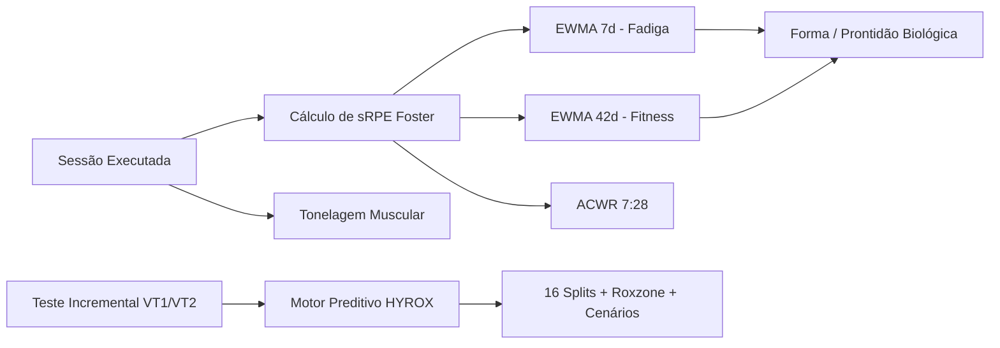

<div align="center">

  <!-- Banner Capsule Render -->
  

  <!-- Subtítulo Animado -->
  <a href="#-visão-geral">
    
  </a>

  <br />
  <br />

  <!-- Badges de Tecnologia e Status -->
  <p align="center">
    
    
    
    
    
    
  </p>

</div>

<br />

---

## 📖 Visão Geral

O **HYROX CONTROL** é uma plataforma analítica **Multi-Atleta** de engenharia de software e ciência do esporte desenvolvida especificamente para a **preparação física de alta performance para a prova HYROX** (ciclo estruturado de 28 semanas / 196 sessões calibradas individualmente para cada atleta e divisão oficial).

A aplicação substitui planilhas estáticas por um ecossistema reativo moderno, 100% interligado entre suas **5 abas principais (`Painel`, `Periodização`, `Diário de Treino`, `Previsão de Prova` e `Análise HYRESULT`)**, integrando:
1. **Gestão Multi-Atleta com Geração Automática de Periodização (28 Semanas)**: cadastro e alternância instantânea de atletas (Open/Pro Masculino e Feminino), gerando automaticamente 7 mesociclos, 28 microciclos e 196 sessões calibradas pelos limiares fisiológicos individuais ($VT_1$, $VT_2$, $VO_2\text{max}$, $PB$ de $5\text{ km}$ e peso corporal).
2. **Monitoramento Biomecânico e Sincronização Estrita de Treinos Confirmados**: todos os 196 treinos iniciam como `PLANEJADO` (`0 / 196` pré-confirmados). Ao confirmar qualquer sessão (inclusive com **1 clique** no Diário de Treino), todas as 5 abas recalculam simultaneamente volume ($km$), intensidade ($RPE$), tonelagem muscular ($\Sigma \text{séries} \times \text{reps} \times \text{carga}$) e carga interna ($sRPE$).
3. **Modelagem Matemática de Fadiga e Prontidão**: cálculo contínuo de curvas de condicionamento físico (*Fitness* EWMA 42 dias) e estresse neuromuscular residual (*Fadiga* EWMA 7 dias) segundo o modelo Banister, além da razão de estresse agudo-crônico (*ACWR*).
4. **Motor Preditivo Contínuo (`S1 → S28`)**: algoritmo que simula a evolução semana a semana ao longo das 28 semanas da periodização (**Planejado vs. Executado Real vs. Projeção Contínua**), decompondo os 16 segmentos da prova (8x $1\text{ km}$ + 8 estações + *Roxzone*) com simulador tático *What-If*.
5. **Telemetria & Análise Padrão HYRESULT (`#LR3MS4JI5A0E80`)**: diagnóstico competitivo completo com **Radar de Percentis de 10 Eixos**, decomposição nos **3 Pilares (Running, Workouts e Roxzone)**, **Fade Index (Desaceleração)**, evolução **treino a treino** e comparação direta com os marcos das fases da periodização (`S6 GPP1`, `S11 GPP2`, `S17 SPP1`, `S21 SPP2`, `S24/S26 COMP` e `S28 TAPER`).

---

## 🔬 Fundamentação Científica & Modelos Matemáticos

A aplicação implementa formulações validadas pela literatura internacional de fisiologia do exercício e periodização desportiva:



### 1. Carga de Sessão (sRPE de Foster)
A carga interna de cada sessão é quantificada pela percepção subjetiva de esforço multiplicada pela duração:
$$\text{Carga (U.A.)} = \text{Duração (min)} \times \text{RPE (Escala 1--10)}$$

### 2. Tonelagem Muscular Total
$$\text{Tonelagem (kg)} = \sum_{i=1}^{n} (\text{Séries}_i \times \text{Repetições}_i \times \text{Carga (kg)}_i)$$

### 3. Modelo Fitness-Fadiga de Banister (EWMA)
Para modelar a adaptação biológica sem defasagem temporal abrupta, utiliza-se a Média Móvel Exponencialmente Ponderada:
$$\text{EWMA}_t = \text{Carga}_t \times \lambda + \text{EWMA}_{t-1} \times (1 - \lambda), \quad \text{onde } \lambda = \frac{2}{N + 1}$$
- **Fitness (Aptidão):** Janela de 42 dias ($N=42$)
- **Fadiga (Sobrecarga):** Janela de 7 dias ($N=7$)
- **Forma / Prontidão:** $\text{Forma} = \text{Fitness} - \text{Fadiga}$

### 4. Razão de Carga Agudo-Crônica (ACWR 7:28)
Controla o risco de lesão através da relação entre a sobrecarga aguda (últimos 7 dias) e o condicionamento acumulado (últimos 28 dias):
$$\text{ACWR} = \frac{\text{Média Diária (7 dias)}}{\text{Média Diária (28 dias)}}$$
- **Zona Segura (*Sweet Spot*):** $0.8 \le \text{ACWR} \le 1.3$
- **Zona de Atenção:** $1.3 < \text{ACWR} \le 1.5$
- **Zona de Perigo (*Danger Zone*):** $\text{ACWR} > 1.5$

### 5. Motor Preditivo de Prova HYROX
Projeta o tempo total da prova decompondo os 16 segmentos oficiais:
$$\text{Tempo Total} = \sum_{k=1}^{8} \text{Run}_k + \sum_{s=1}^{8} \text{Estação}_s + \text{Roxzone}$$
- Velocidade base calibrada por $VT_2$ e $PB$ de $5\text{ km}$.
- Multiplicadores de fadiga neuromuscular por segmento (ex.: *Run 3* pós-Sled Pull $= 1.12$, *Run 8* pós-Wall Balls $= 1.15$).
- Projeção de 3 cenários probabilísticos: **Realista**, **Otimista** ($-3\%$) e **Conservador** ($+5\%$).

---

## ⚡ Funcionalidades da Plataforma

### 1. 📊 Dashboard Analítico Central
- **6 KPI Cards Dinâmicos:** Volume semanal ($km$), Tonelagem acumulada ($kg$), Carga $sRPE$, Aderência Prescrito vs. Realizado, e indicadores biométricos.
- **Gráficos Interativos (Recharts):**
  - Volume semanal e distribuição diária.
  - Curva de Fitness-Fadiga EWMA com histórico temporal e alertas de sobretreinamento.
  - Distribuição percentual do volume por modalidade (Corrida, Força, LPO, Híbrido, Regenerativo).

### 2. 🗓️ Macro e Mesociclos (28 Semanas)
- Estruturação completa em 7 Mesociclos periodizados:
  - `DIAG`: Diagnóstico e baterias de testes fisiológicos (Semana 1).
  - `GPP1` & `GPP2`: Preparação Geral, base aeróbica e capacidade de trabalho (Semanas 2 a 11).
  - `SPP1` & `SPP2`: Preparação Específica com transições Hyrox e estações pesadas (Semanas 12 a 22).
  - `COMP`: Período Competitivo com Meia-Simulação e Simulações Oficiais completas (Semanas 23 a 26).
  - `TAPER`: Polimento neuromuscular e supercompensação energética (Semanas 27 e 28).
- 196 sessões detalhadas com foco, zonas de frequência cardíaca ($Z_1$ a $Z_5$) e prescrição de carga.

### 3. 📝 Diário Semanal & Edição Interativa de Treino
- Navegação entre microciclos com identificação instantânea de dias concluídos, atrasados ou planejados.
- **Session Sheet Lateral:** interface deslizante completa para ajuste fino:
  - Registro de duração, percepção subjetiva de esforço ($RPE$), quilometragem e frequência cardíaca média.
  - Editor de exercícios com séries, repetições e cargas com **recálculo instantâneo de tonelagem**.
  - Registro dos splits das 8 estações HYROX com cálculo de delta em relação à meta.

### 4. 🧘 Acompanhamento de Prontidão e Bem-Estar (Wellness)
- Registro diário de variáveis psicométricas em escala Likert (1 a 5): qualidade do sono, estresse, fadiga muscular, motivação e dores articulares.
- Inserção de marcadores fisiológicos objetivos: frequência cardíaca de repouso ($FC_{\text{rep}}$), variabilidade da frequência cardíaca ($HRV$) e peso corporal.

### 5. ⏱️ HYROX Race Predictor, Curva da Periodização (`S1 → S28`) & Simulador "What-If"
- **Curva de Simulação da Periodização (28 Semanas):** gráfico interativo comparando a **Curva Planejada (`S1 → S28`)**, o **Tempo Simulado Real** (das semanas com treinos confirmados) e a **Projeção Contínua**, com cartões dos marcos de avaliação (`S1`, `S6`, `S11`, `S17`, `S21`, `S24`, `S26`, `S28`).
- **Visão Macro de Prova:** projeção dos cenários Realista, Otimista e Conservador com cálculo de delta contra o objetivo cadastrado.
- **Tabela dos 16 Segmentos:** paces projetados ($min/km$), tempo em cada estação funcional e bandeiras visuais automáticas para estações críticas (tempo $> 15\%$ acima da meta).
- **Simulador Tático:** sliders interativos para ajuste em tempo real de pace de corrida, tempos de estações e transições na Roxzone, recalculando imediatamente a projeção final de tempo.

### 6. 📈 Telemetria Competitiva & Evolução Treino a Treino (Análise HYRESULT)
- **Radar de Percentis de 10 Eixos & 3 Pilares:** comparação contra a distribuição oficial da divisão do atleta (*Running*, *SkiErg*, *Sled Push*, *Sled Pull*, *Burpee Broad Jump*, *Rowing*, *Farmers Carry*, *Sandbag Lunges*, *Wall Balls* e *Roxzone*).
- **Evolução Viva Treino a Treino:** gráfico e feed cronológico mostrando exatamente quantos segundos cada treino confirmado no Diário de Treino economizou nos 3 pilares (*Running*, *Workouts* e *Roxzone*) desde o Diagnóstico Inicial (`#0`).
- **Marcos da Periodização & Importação HYRESULT:** seletor rápido para inspecionar a evolução atual ao vivo, resultados oficiais importados (ex.: `#LR3MS4JI5A0E80`) ou qualquer marco das fases da periodização (`GPP1` a `TAPER`), com recomendações automáticas vinculadas aos mesociclos.

### 7. 👥 Gestão Multi-Atleta com Periodização Individualizada
- **Seletor e Criador de Atletas no Topo:** alterne entre atletas cadastrados (ex.: *Rafael Nogueira — Open M* e *Helena Costa — Open F*) ou cadastre novos atletas informando divisão, peso, altura, FC máx/repouso, $VO_2\text{max}$, paces de $VT_1$/$VT_2$/$5\text{ km}$ e 1RMs, gerando instantaneamente as 28 semanas e 196 sessões calibradas.

---

## 🧱 Arquitetura e Stack Tecnológica

| Camada | Tecnologia | Descrição |
| :--- | :--- | :--- |
| **Framework Full Stack** | **Next.js 16 (App Router)** | Renderização híbrida (Server & Client Components) com alta performance |
| **Biblioteca de UI** | **React 19** | Arquitetura reativa e componentização atômica |
| **Linguagem** | **TypeScript 5** | Tipagem estrita ponta a ponta sem uso de `any` |
| **Estilização & Design** | **Tailwind CSS v4** | Design system responsivo com tema dark esportivo (Zinc, Emerald, Amber, Lime) |
| **Componentes de UI** | **shadcn/ui & Radix UI** | Primitivas acessíveis (Sheet, Dialog, Tabs, Slider, Progress, Sonner) |
| **Visualização de Dados** | **Recharts 2.15** | Gráficos compostos de volume, dispersão, curvas de carga e donuts |
| **Camada de Dados & ORM**| **Prisma ORM 6** | Modelagem robusta de dados e consultas tipadas |
| **Banco de Dados** | **SQLite** (`db/custom.db`) | Armazenamento local-first com latência sub-milissegundo |
| **Validação de Esquemas** | **Zod 4** | Validação em runtime de rotas de API e contratos de predição |

---

## 📂 Estrutura de Diretórios

```text
preparacao_hyrox/
├── prisma/
│   ├── schema.prisma                         # Schema relacional Multi-Atleta (Athlete, Meso, Micro, Session, HyroxResult, etc.)
│   └── seed.ts                               # Seed multi-atleta (28 semanas / 196 sessões PLANEJADAS + Baseline #LR3MS4JI5A0E80)
├── db/
│   └── custom.db                             # Banco de dados SQLite persistente
├── specs/
│   ├── 001-hyrox-race-predictor/             # Spec Kit do módulo preditivo fisiológico
│   ├── 002-profile-readme/                   # Documentação e histórico do portfólio
│   ├── 003-multi-athlete-hyresult-analytics/ # Spec Kit Multi-Atleta & Telemetria HYRESULT
│   ├── 004-live-periodization-evolution/     # Spec Kit Simulação Contínua S1->S28 & Evolução Treino a Treino
│   └── 005-unified-periodization-sync/       # Spec Kit Sincronização Unificada nas 5 Abas & Zero Pré-Confirmados
├── src/
│   ├── app/
│   │   ├── api/                              # Rotas REST (/api/athletes, /api/plan, /api/dashboard, /api/sessions, /api/predictions, /api/hyresult)
│   │   ├── layout.tsx                        # Shell da aplicação com temas e provedores
│   │   └── page.tsx                          # SPA central com 5 abas sincronizadas e seletor multi-atleta
│   ├── components/
│   │   ├── training/                         # Componentes de domínio esportivo
│   │   │   ├── athlete-switcher-dialog.tsx   # Seletor e modal de criação de atletas com calibração fisiológica
│   │   │   ├── dashboard-tab.tsx             # Painel de KPIs, ACWR, Fitness-Fadiga e Wellness
│   │   │   ├── plan-tab.tsx                  # Visão dos 7 Mesociclos e 28 Microciclos
│   │   │   ├── week-tab.tsx                  # Diário de Treino com confirmação rápida de 1 clique
│   │   │   ├── session-sheet.tsx             # Editor completo de sessão (Prescrito vs Realizado)
│   │   │   ├── predictor-tab.tsx             # Previsão de Prova acoplada à Periodização
│   │   │   ├── predictor-periodization-curve.tsx # Curva S1->S28 (Planejado vs Executado vs Projetado)
│   │   │   ├── hyresult-tab.tsx              # Telemetria HYRESULT com marcos da periodização
│   │   │   ├── hyresult-radar-and-pillars.tsx# Radar 10 Eixos, 3 Pilares e Ranking de Percentis
│   │   │   ├── hyresult-evolution-timeline.tsx # Série histórica e feed de impacto treino a treino
│   │   │   └── hyresult-splits-and-roxzone.tsx # Pacing, Fade Index, Raio-X Roxzone e Prescrições
│   │   └── ui/                               # Primitivas visuais do Design System (shadcn/ui)
│   └── lib/
│       ├── analytics.ts                      # Motor de cálculo Foster, EWMA 42:7, ACWR e tonelagem estrita
│       ├── periodization-generator.ts        # Gerador determinístico de 28 semanas / 196 sessões por atleta
│       ├── live-evolution.ts                 # Motor de simulação contínua por sessão e por semana (S1->S28)
│       ├── hyresult-analytics.ts             # Motor de telemetria HYRESULT, percentis e prescrições
│       ├── predictions.ts                    # Motor de predição fisiológica e cenários HYROX
│       ├── predictions-calc.ts               # Funções puras de cálculo de splits e fadiga
│       └── constants.ts                      # Constantes, benchmarks por divisão e validações
├── worklog.md                                # Registro cronológico detalhado de desenvolvimento
└── package.json                              # Dependências e scripts do projeto
```

---

## 🚀 Como Executar o Projeto Localmente

### Pré-requisitos
- **Node.js** (v20 ou superior) ou **Bun** (v1.1 ou superior recomendado)
- **Git**

### Passo a Passo

1. **Clonar o Repositório:**
   ```bash
   git clone https://github.com/Gegeu-sp/preparacao_hyrox.git
   cd preparacao_hyrox
   ```

2. **Instalar Dependências:**
   ```bash
   bun install
   # ou
   npm install
   ```

3. **Configurar as Variáveis de Ambiente:**
   Crie ou verifique o arquivo `.env` na raiz do projeto:
   ```env
   DATABASE_URL="file:./db/custom.db"
   ```

4. **Sincronizar o Banco de Dados Prisma:**
   ```bash
   bun run db:push
   # ou
   npx prisma db push
   ```

5. **(Opcional) Popular o Banco com a Periodização Completa:**
   ```bash
   bun run prisma/seed.ts
   # ou
   npx tsx prisma/seed.ts
   ```

6. **Iniciar o Servidor de Desenvolvimento:**
   ```bash
   bun run dev
   # ou
   npm run dev
   ```

7. **Acessar a Aplicação:**
   Abra o navegador em [http://localhost:3000](http://localhost:3000).

---

## 🧪 Verificação de Qualidade e Linters

Para executar a verificação estática de código e tipagem TypeScript:

```bash
# Executar o ESLint
bun run lint

# Checagem estrita de tipos
npx tsc --noEmit
```

---

<!-- Rodapé Obrigatório -->
<div align="center">

---

### 👨‍💻 Projeto desenvolvido por Argeu Rodrigues
**4º semestre de ADS na Faculdade Anhembi Morumbi**  
**Personal Trainer | CREF: 158814-G/SP**  
*Supervisor no LPO System*

<br />

#### 🌐 Conecte-se comigo / Social Links:

<a href="https://br.linkedin.com/in/argeu-rodrigues-9a6b7174" target="_blank">
  
</a>
<a href="https://github.com/Gegeu-sp" target="_blank">
  
</a>
<a href="mailto:argeurodrigues25@gmail.com" target="_blank">
  
</a>
<a href="https://instagram.com/argeurodrigueslpo" target="_blank">
  
</a>

<br /><br />

<sub>*"Onde a precisão da engenharia de software potencializa a ciência da performance humana."*</sub>

</div>
