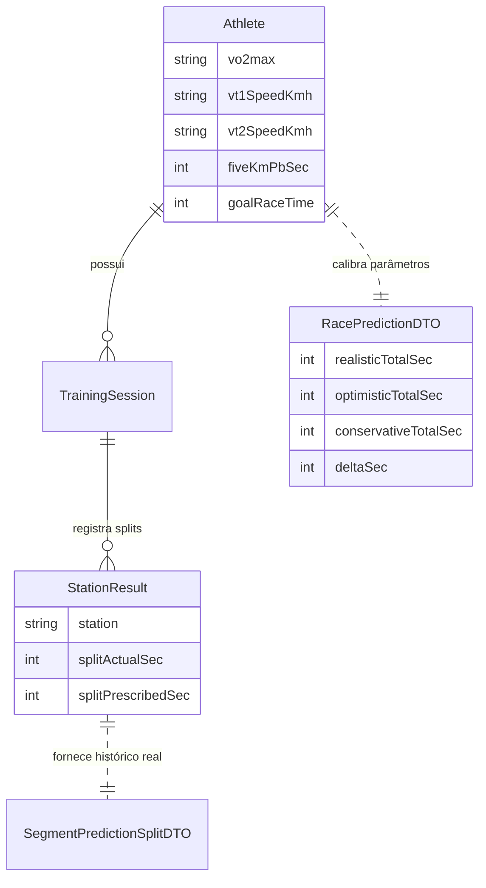

# Data Model: Módulo Preditivo HYROX

**Feature**: `001-hyrox-race-predictor`
**Data**: 2026-10-27
**Status**: Concluído

## 1. Entidades de Domínio e Estruturas de Dados

### 1.1 RacePredictionDTO
Representa a previsão completa gerada para o atleta no ponto atual da preparação.

```typescript
export interface RacePredictionDTO {
  generatedAt: string // ISO 8601
  athleteName: string
  targetGoalTimeSec: number // ex.: 4500 (01:15:00)
  targetGoalTimeFormatted: string // "01:15:00"
  
  // Cenários preditivos globais
  realisticTotalSec: number
  realisticFormatted: string
  optimisticTotalSec: number
  optimisticFormatted: string
  conservativeTotalSec: number
  conservativeFormatted: string

  // Composição temporal
  totalRunSec: number
  totalRunFormatted: string
  totalStationsSec: number
  totalStationsFormatted: string
  roxzoneSec: number
  roxzoneFormatted: string

  // Análise comparativa
  deltaSec: number // realisticTotalSec - targetGoalTimeSec
  deltaFormatted: string // ex: "+01:32" ou "-00:45"
  deltaPct: number // ex: +2.1%
  isWithinGoal: boolean

  // Nível de precisão e avisos
  confidenceLevel: 'ALTA' | 'MEDIA' | 'ESTIMATIVA_INICIAL'
  simulationCountUsed: number
  criticalStations: string[]
  warnings: string[]

  // Detalhamento dos 16 segmentos
  segments: SegmentPredictionSplitDTO[]
}
```

### 1.2 SegmentPredictionSplitDTO
Representa cada um dos 16 segmentos oficiais da prova HYROX mais o tempo de transição.

```typescript
export type SegmentType = 'RUN' | 'STATION' | 'ROXZONE'

export interface SegmentPredictionSplitDTO {
  order: number // 1 a 16
  segmentKey: string // ex.: "RUN_1", "SKIERG", "RUN_2", "SLED_PUSH", ..., "WALLBALLS"
  type: SegmentType
  name: string // "Corrida 1 (1 km)", "Sled Push (50m)", etc.
  distanceM: number | null
  reps: number | null
  predictedSec: number
  predictedFormatted: string // "04:45"
  targetSec: number | null
  targetFormatted: string | null
  paceMinKmFormatted: string | null // "4:45/km" (apenas para corridas)
  fatigueFactorApplied: number // ex: 1.0 (Run 1), 1.12 (Run 3 pós-Sled)
  isCritical: boolean // gargalo identificado
  historicalBestSec: number | null
}
```

### 1.3 PredictionScenarioInput (Simulador "What-If")
Payload utilizado para recalcular a projeção com parâmetros alternativos sem persistência destrutiva.

```typescript
export interface PredictionScenarioInput {
  basePaceAdjustmentSec?: number // ajuste em segundos por km (ex: -5 ou +10)
  stationAdjustments?: Record<string, number> // ajustes pontuais por estação (ex: {"SLED_PUSH": -15})
  roxzoneAdjustmentSec?: number // delta no tempo de transição
  customGoalTimeSec?: number // nova meta para comparação
}
```

---

## 2. Relação com Entidades Existentes (Prisma SQLite)



### Regras de Consistência e Validação:
1. **Consistência Matemática**: $\sum_{i=1}^{16} \text{SegmentSec}_i + \text{RoxzoneSec} = \text{TotalTimeSec}$ (erro absoluto = 0).
2. **Faixas de Tempo Válidas**:
   - Cada trecho de corrida de 1km deve situar-se entre `03:00` (180s) e `10:00` (600s).
   - Estações funcionais devem respeitar limites fisiológicos mínimos e máximos da prova Open M.
3. **Detecção de Gargalo**: Qualquer estação cujo tempo projetado exceda a meta em mais de $15\%$ ou que gere decaimento na corrida subsequente superior a $10\%$ é classificada com `isCritical = true`.
